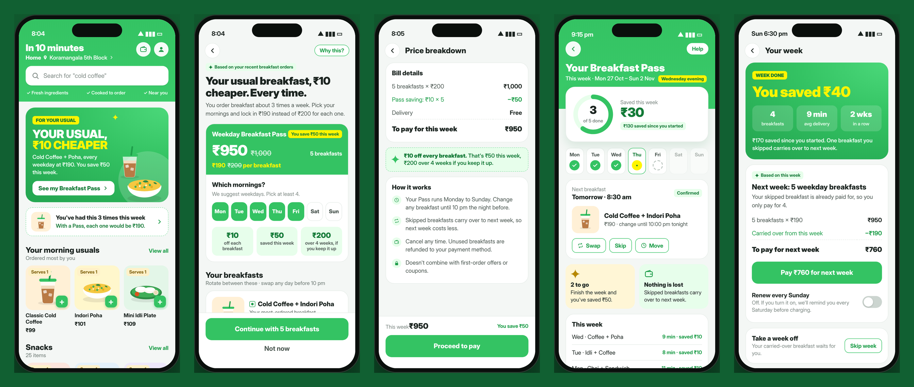
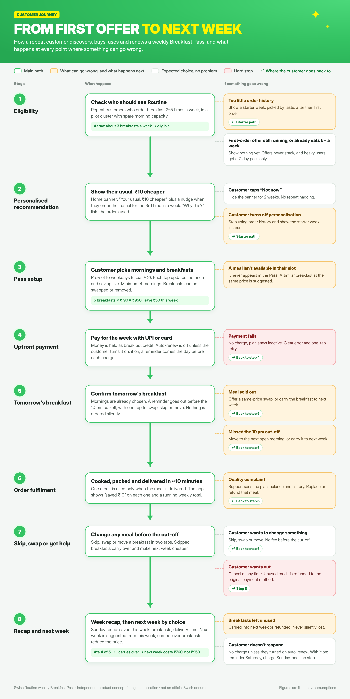
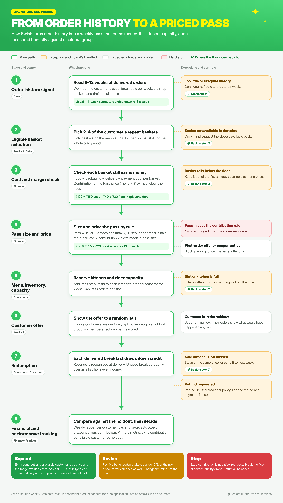
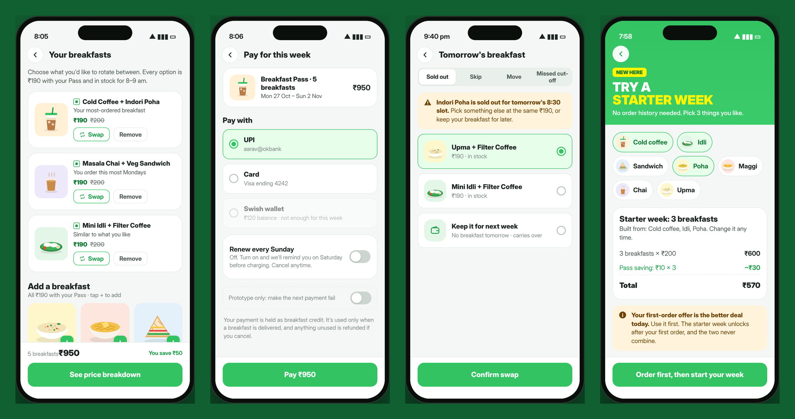

# Swish Routine: a weekly Breakfast Pass

Oct 25, 2026 · @Kartar

**The idea in one line:** your usual breakfast, ₹10 cheaper every time, in a weekly pass sized a little above your habit, so the extra breakfasts more than pay for the discount.

- **For the customer:** 5 weekday breakfasts at ₹190 instead of ₹200. Pay ₹950 for the week, save ₹50, and watch it add up to ₹200 over 4 weeks.
- **For Swish:** a customer who goes from 3 to 5 breakfasts a week adds about ₹50 of contribution a week; one who doesn't change costs ₹30. It pays once roughly 38% of buyers eat more.
- **Proved, not assumed:** a 2-week demand check, then a 6-week randomised pilot judged on extra contribution per eligible customer against a holdout.



*Clickable prototype in Swish's visual style: [`prototype/index.html`](prototype/index.html). An independent proposal written for a Product, Growth or Operations role. It uses no Swish internal data; every cost and behaviour figure is a labelled assumption.*

## 1. Executive recommendation

**Pilot a weekly Breakfast Pass: the customer's usual breakfast, ₹10 cheaper on every meal, sized 2 mornings above their habit.** Start with repeat breakfast customers in a few kitchen clusters, measured against a holdout.

**What to test.** A weekly pass built from the customer's own orders. Aarav orders cold coffee and poha about 3 times a week. Swish offers 5 weekday breakfasts at ₹190 each (menu price ₹200): ₹950 for the week, ₹50 saved. He picks his mornings and can swap, skip or move any breakfast. Skipped ones carry over to next week.

**Why weekly, not monthly.** ₹950 is a far easier yes than ₹2,360 upfront. A week matches how people plan breakfast, gives Swish a read on behaviour every 7 days instead of every 30, and keeps the prepaid balance Swish owes small.

**Who sees it.** Customers who order breakfast 2–5 times a week in a few dense kitchen clusters. Not customers inside a first-order offer, and not customers already ordering 6 or more a week: for them it would only be a discount on orders Swish already has.

**Why customers will buy it.** The benefit is concrete and repeated: "₹190, not ₹200" on the breakfast they already order, a running "saved this week" total, and a Sunday recap. It is real money on a real habit, made visible, not a trick (section 6).

**How Swish wins.** Contribution per pass breakfast falls from ₹50 to ₹40, but two extra breakfasts a week add ₹80, so each customer who uses the pass adds ₹50 a week. Cash arrives on Sunday for the whole week and kitchens see next week's demand in advance. Cash received is not profit: Swish still owes every breakfast.

**What must be true:**

- About 38% or more of buyers must genuinely eat more (at ₹150 cost and ₹10 off).
- The pass must sit at least 2 mornings above the customer's habit. At or below habit it is just a discount.
- Each pass breakfast must still clear the cost floor: ₹190 minus its cost must be at least the floor.
- Real variable cost must stay below about ₹175 per basket. Above that the pass loses money even when used fully.

**Biggest reason it could fail.** Customers buy the pass but keep their old habit, so Swish gives ₹10 off breakfasts it would have sold anyway: −₹30 a week each. The holdout shows this quickly, and a weekly pass means a bad bet costs one week, not a month.

**Decision: pilot.** Two steps: a 2-week demand check with no payment built, then a 6-week randomised pilot against a holdout. Stop if extra contribution per eligible customer isn't positive.

### Why this fits Swish specifically

- **Owned kitchens turn a pass into a prep forecast.** A marketplace passes planned orders on to restaurants. Swish cooks them itself, so knowing next week's 8:30 am breakfasts by Sunday night could cut waste and smooth kitchen load. This is my interpretation; Swish's own data would confirm it.
- **The habit already exists.** Swish told TechCrunch its top users order more than 10 times a month. The pass packages a habit instead of trying to create one.
- **Much of the plumbing appears to exist.** Swish's Play Store screenshots show referral rewards paid into a "Swish wallet" and live order tracking. Pass credit could sit in that wallet. I don't know how it is built, so engineering should size this.
- **Offer clarity is a live issue.** A September 2026 Play Store review complains that a free-coffee offer needed repeat orders and was not applied. The pass shows one bill, one price and no stacking.
- **Breakfast first, lunch next.** Swish says lunch and dinner now outrank snacks. Breakfast is the cleanest pilot because it is the most routine occasion; a lunch pass is the bigger prize if it works.

*Unknowns I can't resolve without Swish data: real variable cost per basket, how often repeat customers order breakfast each week, how many would genuinely eat more, and the accounting and tax treatment of prepaid credit.*

## 2. Evidence: what is verified, what I interpret, what I assume

Swish is growing fast and its customers already order often, which makes a routine-based plan plausible. Nothing public shows Swish's per-order costs, so every cost figure here is an assumption.

### Verified public facts (as of 25 Oct 2026)

| Fact | Source |
| --- | --- |
| Swish owns its kitchens, sourcing and delivery, with no third-party platform in between. | [Swish site](https://justswish.in/) |
| In March 2026 Swish reported about 20,000 orders a day, average order value of ₹200–250, and top users ordering more than 10 times a month. | [TechCrunch, 23 Mar 2026](https://techcrunch.com/2026/03/23/bengaluru-food-startup-swish-raises-38m-in-its-third-round-in-18-months/) |
| Older kitchen clusters were profitable, but per-order margins were not disclosed. | [TechCrunch](https://techcrunch.com/2026/03/23/bengaluru-food-startup-swish-raises-38m-in-its-third-round-in-18-months/) |
| Update since the brief's sources: in September 2026 Swish raised $24M, said monthly orders passed 1 million (tripled since March), and said lunch and dinner now outrank snacks and late night. It lists 250+ items across Bengaluru, Gurugram, Noida, Delhi and Ghaziabad. | [Entrepreneur India, 11 Sep 2026](https://india.entrepreneur.com/?p=99580) |
| The Play listing shows 4.6–4.7 stars from 20–22K reviews (varies by store region), updated 27 Sep 2026. One recent review complains that a cheap-coffee offer needed extra orders and the free item was not applied. Lesson: offer rules must be clear and automatic. | [Google Play](https://play.google.com/store/apps/details?id=com.swishapp) |
| Zomato's Healthy Subscriptions lets users schedule multi-day meal plans from selected partner restaurants, with a shuffle option, in Delhi, Mumbai and Bangalore. | [Verdict Food Service, 29 May 2026](https://www.verdictfoodservice.com/newsletters/zomato-launches-healthy-subscriptions-option-for-planned-meals) |
| Eternal shut Zomato Quick and Zomato Everyday in May 2025, saying it saw no path to profitability without hurting customer experience. Coverage says Everyday demand was limited, mostly to office locations in metros. | [Outlook Business](https://www.outlookbusiness.com/start-up/e-commerce/eternal-q4-results-deepinder-goyal-doesnt-see-profitability-path-in-zomatos-2-initiatives), [Angel One](https://www.angelone.in/news/share-market/eternal-share-price-in-focus-on-may-2-q4-fy25-profit-falls-despite-revenue-surge) |

**From Swish's Play Store screenshots (viewed 25 Oct 2026):** a first-order offer of 50% off plus a free cold coffee, referral credit paid into a "Swish wallet", "Serves 1" and "Bestseller" tags on food cards, and live order tracking with chef and rider cards. The prototype follows this visual language, and the no-stacking rule is written with the first-order offer in mind.

**Indian rules that shape the design.** India's consumer regulator (CCPA) notified Guidelines for the Prevention and Regulation of Dark Patterns on 30 Nov 2023. They name 13 practices, including false urgency, confirm shaming, subscription traps, drip pricing and nagging ([JSA summary](https://www.jsalaw.com/newsletters-and-updates/ccpa-issues-guidelines-for-prevention-and-regulation-of-dark-patterns-2023/)). RBI's e-mandate rules require a pre-debit alert at least 24 hours before each recurring charge and let customers cancel a mandate at any time ([Outlook Business summary](https://www.outlookbusiness.com/ampstories/news/rbi-e-mandate-framework-2026-new-rules-for-auto-pay-upi-cards-wallets)). Both are secondary summaries; Legal should check the original texts.

**What I could not verify.** Zomato's own announcement and subscription terms block automated access, and the Eternal annual report PDF was too large to open. I used trade-press coverage for Zomato and did not read the terms. Read the original pages before quoting them in an interview.

### My interpretation (not fact)

- Swish's own-kitchen model means a discount is Swish's own margin, not a partner's. Zomato's partner-based plans may not transfer directly: I do not know who funds Zomato's discounts, and I have not assumed it.
- Everyday's closure is a warning that planned, scheduled meals can have thin or concentrated demand. It does not say whether Swish's repeat snacking and breakfast behaviour would behave the same way.
- The growth in lunch and dinner means breakfast should be the pilot, not the end state: if Routine works, lunch is where it scales.

### Assumptions (illustrative, replace with Swish data)

3 breakfasts a week today, a 5-breakfast weekday pass, ₹200 basket, ₹150 variable cost, ₹10 off each pass breakfast, ₹30 minimum contribution per discounted basket, 15% take-up, 50% of buyers eating more.

## 3. BRD: business requirements

### Problem and opportunity

Swish's repeat customers already have a breakfast habit, but each order is a fresh decision: some mornings they skip, cook, or order elsewhere. A weekly pass makes the next breakfast the default, at a price that feels better, and gives Swish the week's demand upfront. The risk is paying ₹10 off on breakfasts Swish would have sold anyway.

### Target segments

| Segment | Who | Offer | Main risk |
| --- | --- | --- | --- |
| Regulars with room to grow | Breakfast 2–5 times a week | Pass = usual + 2 mornings, ₹10 off each (a 5-a-week customer gets a 7-day pass) | Buys but doesn't eat more |
| Daily already | 6–7 breakfasts a week | No pass: it would only discount existing orders | Pure discount cost |
| Occasional | Under 2 a week | No personalised pass in the pilot; starter week only | Unused breakfasts and refunds |
| New, no history | No order yet | Starter week of 3 breakfasts, after the first order | Stacking with the first-order offer |

### Customer value and Swish value

- **Customer:** ₹10 off the breakfast they already order, every time; a visible weekly saving; no re-ordering; skip, swap and carry-over; a small weekly commitment.
- **Swish:** more breakfasts per customer, a weekly demand forecast per kitchen, cash a week ahead, and a habit that is harder for competitors to break.

### Four numbers that must not be mixed up

| Term | Meaning | Weekly example |
| --- | --- | --- |
| Order revenue (sales) | Value of breakfasts delivered | ₹950 once all 5 are delivered |
| Cash collected | Money received when the pass is bought | ₹950 on Sunday, with ₹950 of breakfasts still owed |
| Contribution | Sales minus variable costs, before fixed costs | ₹200 vs ₹150 before: +₹50 |
| Profit after fixed costs | Contribution minus kitchens, tech, people, marketing | Unknown: needs Finance |

### Revenue and cash-flow model

The customer pays on Sunday for the coming week. Each breakfast is recognised as revenue when delivered. Unused breakfasts carry over (a liability) or are refunded on cancellation; they are never income. A weekly cadence keeps the liability small: at most one week of breakfasts per customer, plus any carry-over.

### Costs the pass must carry

| Cost | Why it matters here |
| --- | --- |
| Food and packaging | After ₹10 off, each basket must still clear the floor |
| Delivery | Fixed morning slots may allow batching and lower cost |
| Payment fees | One payment a week instead of one per order may lower fees; refunds may not return them |
| Discounts | ₹10 per pass breakfast, never stacked with other offers |
| Refunds and support | Carry-over reduces refunds; budget support time per pass |
| Marketing and CRM | Banner, in-the-moment nudge, reminders, holdout design |
| Product and engineering | Pass setup, weekly ledger, reminders, recap |
| Capacity and waste | A weekly forecast should cut waste; slot caps protect delivery time |
| Taxes and prepaid accounting | GST timing, carry-over and refunds: Finance and tax advisers to rule |

### Facts to verify before any real price

Real variable cost per basket by kitchen and slot; how often repeat customers order breakfast each week; how many would eat more versus a holdout; legal review of auto-renew, refunds and carry-over; accounting for prepaid credit; how first-order offers are funded and excluded.

### Business risks and mitigations

| Risk | Mitigation |
| --- | --- |
| Pays ₹10 on breakfasts that would have happened anyway | Pass sized usual + 2; daily customers excluded; holdout measures the true effect |
| Cost per basket higher than assumed | Cost floor per basket; break-even cost is about ₹175 at ₹10 off |
| Customers feel tricked or trapped | No dark patterns (section 6); auto-renew opt-in; two-tap cancel |
| Morning slot overload | Weekly forecast and slot caps per kitchen |
| Prepaid cash treated as profit | Weekly ledger shows the liability; carry-overs are never booked as income |
| Stacking with first-order offers | Hard exclusion in the pricing engine |

### Pilot success criteria

Continue only if extra contribution per eligible customer, after discount, refunds, support and waste, is positive against the holdout, with a range that excludes zero (section 7).

## 4. PRD: product requirements

### Goal and non-goals

**Goal:** let a repeat customer lock in their usual breakfast at ₹10 less for the week, make the saving visible, and measure whether it creates extra contribution.

**Non-goals:** ordering without the customer; a general coupon; replacing first-order offers; counting unused credit as income; auto-renewal by default.

### Personas and user stories

| Persona | Story |
| --- | --- |
| Aarav, 27, cold coffee and poha about 3 mornings a week | As Aarav, I want my usual at a better price on the mornings I choose, so I stop re-ordering and can see what I save. |
| Meera, 31, about 2 mornings, unpredictable weeks | As Meera, I want skipped mornings to carry over, so a busy week doesn't waste money. |
| Kabir, new, no orders yet | As Kabir, I want a small starter week chosen by taste, without needing any history. |
| Ops lead | As Ops, I want next week's pass breakfasts per kitchen and slot by Sunday night, with caps. |
| Finance analyst | As Finance, I want each pass priced from real costs with a hard floor, and a weekly liability ledger. |

### Eligibility rules

- Breakfast 2–5 times a week, averaged over the last 4 weeks, in a pilot cluster with spare morning capacity.
- Every basket in the pass must clear the cost floor at ₹10 off.
- Excluded: customers inside a first-order offer, customers already ordering 6+ breakfasts a week, holdout customers, and anyone with an open refund dispute.
- No stacking with codes or first-order offers: the engine shows the better offer only.

### Estimating the usual pattern

1. Take 4–8 weeks of delivered breakfast orders.
2. Usual = average per week, rounded down (13 in 4 weeks → 3).
3. Find the 2–4 most frequent baskets, the usual time slot and the usual weekdays.
4. Suggest pass size = usual + 2 (maximum 7), pre-selecting their most common mornings.
5. If history is thin or irregular, show the starter week, without "based on your orders" wording.

### Pass setup and pricing

The customer sees each morning as a tap target, with the price (mornings × ₹190), the saving (mornings × ₹10) and the 4-week total updating live. Minimum 4 mornings, so the pass is always above a 3-a-week habit. Pass price per breakfast = menu price − ₹10. The pricing service checks each basket's contribution at that price against the floor and never shows a basket that fails. The discount per breakfast must stay at or below half of contribution × (pass − usual) ÷ pass.

### Customer controls

| Action | Rule |
| --- | --- |
| Pick mornings | Any 4–7 mornings; price and saving update live |
| Swap | Any pass breakfast at ₹190, until 10 pm the night before |
| Skip | Carries over to next week; next week's price drops by ₹190 |
| Move | To another open morning in the same week, subject to capacity |
| Take a week off | Skip a whole week; carried-over breakfasts wait |
| Renew | Sunday recap suggests next week from this week's actual use; pay in one tap |
| Auto-renew | Off by default. If turned on: reminder every Saturday, pre-debit alert at least 24 hours before charging, one-tap stop |
| Cancel | Two taps from the same screen as renew; unused breakfasts refunded |

No order is placed silently: every pass breakfast comes from mornings the customer chose, with a reminder the night before.

### Edge states

| State | What happens |
| --- | --- |
| Breakfast sold out | Same-price swap, or carry it to next week |
| Too little history | Starter week by taste; no personalised wording |
| Payment failure | Pass stays inactive; one retry prompt; no partial activation |
| Missed cut-off | Next open morning, or carry over; the customer is told which |
| Refund request | Unused breakfasts refunded; delivered ones only for a quality issue |
| Auto-renew charge fails | Pass not renewed; one reminder; no repeated retries |
| Support | Help shows the pass, balance, carry-overs and swaps |

### Privacy and transparency

- Say "Based on your recent breakfast orders" and nothing more personal.
- "Why this?" lists the exact signals used: count, top basket, usual time.
- One-tap opt-out of personalisation, which falls back to the starter week.
- Use order history only for this purpose and as the privacy policy allows; legal review before launch.
- The struck-through ₹200 is always the live menu price.

### Acceptance criteria

1. Price, saving and number of breakfasts update on every morning tap and match the bill exactly.
2. No basket below the cost floor appears in a pass.
3. A pass price never stacks with a first-order offer or code.
4. Auto-renew is off by default; when on, a reminder appears at least 24 hours before each charge and stopping takes one tap.
5. Cancel is reachable in two taps from the pass screen and shows the exact refund before confirming.
6. Every saving shown ("saved this week", "since you started") is computed from delivered breakfasts only.
7. Holdout customers see no pass, banner or nudge.

## 5. Pricing and financial model

At the brief's illustrative numbers, a ₹10-off weekly pass adds ₹50 a week for each customer who goes from 3 to 5 breakfasts, and costs ₹30 a week for each who doesn't change. It is worth piloting because it pays once roughly 38% of buyers eat more. All figures are assumptions; the workbook in [`model/`](model/) has the same numbers with live formulas.

### Step 1: one customer, one week

| Line (₹ per week) | Before | With pass | Change |
| --- | --- | --- | --- |
| Breakfasts | 3 | 5 | +2 |
| Price each | 200 | 190 | −10 |
| Sales | 600 | 950 | +350 |
| Variable cost (₹150 each) | 450 | 750 | +300 |
| Contribution before fixed costs | 150 | 200 | +50 |
| Contribution per breakfast | 50 | 40 | −10 |
| Cash received upfront | 0 | 950 | +950 (breakfasts still owed) |

**The customer's view.** ₹190 instead of ₹200 on every breakfast: ₹50 saved this week, ₹200 over 4 weeks if they keep it up. Weekly spend goes from ₹600 to ₹950 because they get 2 more breakfasts; each extra one effectively costs ₹175. The app shows this honestly.

**For 1,000 subscribers who all use the full pass:** +₹50,000 contribution a week, about ₹2.2 lakh a month. That is the best case; Step 4 shows realistic mixes.

### Step 2: the rule that keeps the discount safe

```latex
\text{Extra contribution per week} = (N_{pass} - N_{usual}) \times c - N_{pass} \times d
```

Here **c** is contribution per full-price breakfast (₹200 − ₹150 = ₹50) and **d** is the discount per pass breakfast. Check: (5 − 3) × 50 − 5 × 10 = **₹50**.

- **Break-even discount:** d = c × (pass − usual) ÷ pass = 50 × 2 ÷ 5 = **₹20** per breakfast. Above that, Swish earns less even when the customer uses every breakfast.
- **Recommended discount:** half of break-even, so **₹10**. Swish keeps half of what the extra breakfasts earn.
- **Break-even cost:** at ₹10 off, a full-use customer stops paying once variable cost passes **₹175** per basket.
- **Cost floor:** ₹190 − ₹150 = ₹40 per pass breakfast, above the ₹30 placeholder floor. In the illustrative basket list, a rice-bowl combo earns only ₹25 at ₹10 off, so it stays out of the pass.

### Step 3: pass size matters more than the discount

Extra contribution per week for a customer who uses the whole pass (₹10 off, ₹150 cost). A dash means the pass is never offered.

| Usual breakfasts a week | 4-pass | 5-pass | 6-pass | 7-pass |
| --- | --- | --- | --- | --- |
| 2 | +₹60 | +₹100 | +₹140 | +₹180 |
| 3 | +₹10 | +₹50 | +₹90 | +₹130 |
| 4 | — | ₹0 | +₹40 | +₹80 |
| 5 | — | — | −₹10 | +₹30 |

A pass only one morning above habit barely pays. Hence the rule: usual + 2, capped at 7.

### Step 4: what really happens

Carried-over breakfasts stay owed to the customer; they are never booked as income.

| Scenario (₹ per week) | Sales recognised | Discount given | Variable cost | Contribution | Extra vs no pass | Carried over |
| --- | --- | --- | --- | --- | --- | --- |
| A. Buys a 5-pass, still eats 3 | 570 | 30 | 450 | 120 | **−30** | 2 breakfasts |
| B. Eats 4 | 760 | 40 | 600 | 160 | **+10** | 1 breakfast |
| C. Eats all 5 | 950 | 50 | 750 | 200 | **+50** | none |
| D. Eats 5, plus 1 at full price | 1,150 | 50 | 900 | 250 | **+100** | none |
| E. Already eats 5, offered a 5-pass | 950 | 50 | 750 | 200 | **−50** | never offered |
| F. Already eats 5, 7-day pass, eats 7 | 1,330 | 70 | 1,050 | 280 | **+30** | none |

**Trap to avoid.** If carried-over breakfasts quietly expired and were booked as income, Scenario A would look profitable. That is the "tricked" outcome that customers and regulators punish, so it never appears in the business case.

### Step 5: sensitivity

**Expected extra contribution per subscriber per week, by share who eat more (₹10 off):**

| Variable cost | 30% eat more | 40% | 50% | 60% | 80% |
| --- | --- | --- | --- | --- | --- |
| ₹130 | +₹6 | +₹18 | +₹30 | +₹42 | +₹66 |
| ₹150 | −₹6 | +₹2 | +₹10 | +₹18 | +₹34 |
| ₹170 | −₹18 | −₹14 | −₹10 | −₹6 | +₹2 |

**Share of buyers who must eat more to break even:**

| Discount per breakfast | ₹130 cost | ₹150 cost | ₹170 cost |
| --- | --- | --- | --- |
| ₹5 | 12% | 17% | 30% |
| ₹10 | 25% | 38% | 75% |
| ₹15 | 41% | 64% | never |

**1,000 eligible customers, extra contribution per month (₹150 cost, ₹10 off):**

| Share who buy | 30% of buyers eat more | 50% | 80% |
| --- | --- | --- | --- |
| 10% | −₹2,598 | +₹4,330 | +₹14,722 |
| 20% | −₹5,196 | +₹8,660 | +₹29,444 |

These are not forecasts. They show the case hinges on two things only Swish can measure: real cost per basket and real behaviour change.

### Pricing rule I recommend

1. Pass size = usual + 2 mornings (maximum 7). Never offer a pass at or below the customer's habit.
2. Pass price = menu price − d, where d ≤ ½ × c × (pass − usual) ÷ pass.
3. Every basket must clear the floor at the pass price, or it stays out of the pass.
4. No stacking with first-order offers or codes.
5. Re-check d whenever Finance updates costs; d can differ by kitchen.

### Prepaid cash: what it is and is not

Weekly cash helps timing and shows next week's demand by Sunday. It is not profit: Swish still owes the breakfasts, may owe refunds and may owe tax on the receipt. **Questions for Finance:** how to treat the balance owed and when revenue is recognised; a carry-over limit (for example, 2 weeks) and what happens after it; refund timing and payment-fee recovery; GST timing on prepaid credit; and whether the Swish wallet counts as a prepaid payment instrument with its own rules.

### What Finance must supply before a real price is approved

Variable cost per basket by kitchen and slot; payment, refund and waste costs; the minimum contribution floor; how often eligible customers order breakfast each week; tax and accounting treatment; and approved refund and carry-over rules.

## 6. Behavioural design: make the real saving felt

Customers should feel the saving because it is real and visible, not because they were misled. Every lever below either shows a true benefit more clearly or removes friction; none hides a cost. That is also the law: India bans 13 named dark patterns (section 2), and a habit product only pays if customers trust it enough to stay.

| Lever | What the customer sees | Why it works | Guardrail |
| --- | --- | --- | --- |
| Concrete framing | "₹190, not ₹200" on the exact breakfast they already order | A gain tied to a familiar purchase is easier to value than an abstract percentage (mental accounting) | ₹200 is always today's live menu price, never an inflated "was" price |
| Make it add up | "Saved this week ₹30", "₹130 since you started", and a Sunday recap | Small repeated gains feel bigger when they are summed and shown | Totals count delivered breakfasts only; future savings always say "if you keep it up" |
| Pay once, enjoy all week | One weekly payment; each breakfast already feels sorted | Separating payment from eating reduces the pain of paying | The full weekly price is shown once, before payment; no fees appear later |
| Smaller first yes | ₹950 a week instead of ₹2,360 a month | A smaller commitment lowers perceived risk | Same per-breakfast saving; no lock-in |
| Sized default | Pass pre-set to the customer's usual weekdays + 2, one tap per day to change | Defaults are sticky, so a usual + 2 default nudges a little more breakfast | Never below 4 or above 7 mornings; nothing pre-added |
| Ownership | "Your Breakfast Pass", with their mornings and their breakfasts | People value what they chose and set up themselves | Any breakfast can be removed; personalisation can be switched off |
| Plan the moment | Chosen mornings plus a 10 pm reminder with one-tap confirm | Turning "I should" into "Mon–Fri at 8:30" builds habits | One reminder a night; no repeated pop-ups |
| Progress | "3 of 5 done" and "2 to go: finish the week and you've saved ₹50" | People speed up as they near a goal | Missed breakfasts carry over, so there is no fake loss |
| End on a high | Sunday recap: money saved, average delivery time, weeks in a row | People remember the best moment and the end of an experience | The recap shows real numbers only |
| Right moment | "You've had this 3 times this week. With a Pass, each would be ₹190." | An offer lands best when it matches what you are doing right now | Shown at most once a week; "Not now" hides it for 2 weeks |
| Safety net | "Cancel any time, unused breakfasts refunded", shown before paying | Removing risk raises willingness to try | Cancel in two taps; the refund is shown before confirming |

### Lines we won't cross

| Dark pattern (CCPA list) | What we do instead |
| --- | --- |
| False urgency: "Only 2 passes left", fake timers | No timers or stock claims unless a slot is genuinely full |
| Subscription trap: hard to cancel, auto-renew on by default | Auto-renew off by default; reminder at least 24 hours before every charge; two-tap cancel |
| Confirm shaming: "No thanks, I like paying more" | A plain "Not now" |
| Drip pricing: fees revealed at checkout | One price, shown in full on the bill before payment |
| Basket sneaking: add-ons pre-ticked | Nothing is added that the customer didn't pick |
| Nagging | Banner hidden for 2 weeks after "Not now"; nudge at most once a week |
| Interface interference: fake "was" prices | The struck-through price is always the live menu price |

**Why this is the commercially smart choice too.** A breakfast habit only pays if it lasts for months. A customer who feels tricked cancels and tells friends; Swish's Play Store reviews already show what happens when an offer feels like a trick. The pilot tracks week-1 cancellations and "felt misled" complaints alongside contribution.

## 7. Pilot and measurement plan

Validate in two steps: a cheap 2-week demand check, then a 6-week randomised pilot in a few kitchen clusters, judged on extra contribution per eligible customer against a holdout. Sign-ups, prepaid cash and gross orders are not evidence of success on their own.

### Design

| Item | Choice | Why |
| --- | --- | --- |
| Phase 0: demand check | 2 weeks. A random sample of eligible customers sees the banner and pass, with "Join the early list" instead of payment | Tests interest before any wallet or payment work is built |
| Area | 2–3 dense kitchen clusters with spare morning capacity | Enough eligible customers for a clean read |
| Meal occasion | Breakfast first; lunch next if it works | Breakfast is the most routine occasion. Swish says lunch and dinner are now its biggest occasions, so a lunch pass is the scale-up |
| Eligible customers | Breakfast 2–5 times a week over the last 4 weeks; no first-order offer active | Matches PRD eligibility |
| Assignment | Random at customer level, after eligibility is set | Removes selection bias |
| Length | 2-week baseline, 6 weekly cycles, then a 4-week tail | Six renewal decisions per customer, plus how habits hold afterwards |

### Groups

| Group | What they see |
| --- | --- |
| Holdout (control) | Nothing new; no banner, nudge or reminders |
| Breakfast Pass, ₹10 off | Pass sized usual + 2, auto-renew off by default |
| Optional: Breakfast Pass, ₹5 off | Same pass, half the discount. Tests whether a smaller saving moves people as much; add only if the clusters supply enough customers |

### Primary metric

**Extra contribution per eligible customer** (everyone offered, not just buyers) versus the holdout, over the 6 weeks and the tail:

```latex
\Delta = \bar{x}_{offer} - \bar{x}_{holdout}, \quad x = \text{sales} - \text{variable cost} - \text{discounts} - \text{refunds} - \text{extra support and waste}
```

Use customers' pre-period orders to reduce noise.

### Telling caused orders from orders that would have happened anyway

- Compare **everyone offered** with **everyone in the holdout**, including those who didn't buy. Comparing buyers with non-buyers is biased, because buyers are the keen customers.
- The holdout's breakfasts show what offered customers would have ordered anyway. Anything above that is caused by the pass.
- Read take-up, then the effect among buyers (the offer effect divided by take-up).
- Check that lunch, snack and dinner orders didn't fall (cannibalisation), and that breakfasts don't drop below baseline after customers stop renewing.

### Supporting metrics

| Group | Metrics |
| --- | --- |
| Demand | Take-up, breakfasts per week, share of buyers eating more, week-to-week renewal, auto-renew opt-in rate |
| Money | Discount cost, cash collected, carried-over breakfasts, refunds, payment costs |
| Quality | Availability, kitchen waste, delivery time and reliability, complaints, support contacts per pass |
| Trust | Cancellations in week 1, "felt misled" complaints, Play Store mentions |

### How big must the test be

Assume 15% take-up, half of buyers adding 2 breakfasts a week, and the usual spread in weekly orders after adjusting for each customer's past orders. Then each group needs about 800 eligible customers to detect the effect with 80% power (workbook, Pilot Power tab): about 1,600 for two groups, 2,400 with the ₹5 group. That is far smaller than a monthly design would need, because the effect per customer is bigger and is measured every week. These inputs are placeholders for Swish's data team.

### Decision rules (placeholders for Swish to confirm)

| Decision | Condition |
| --- | --- |
| **Continue and expand** | Extra contribution per eligible customer is positive and its 95% range excludes zero; at least about 38% of buyers eat more; delivery time and complaints are no worse than the holdout; week-1 cancellations are under an agreed level |
| **Revise** | Positive but the range includes zero; take-up under 5%; only one segment works; or the ₹5 group does as well as ₹10 (cut the discount) |
| **Stop** | Extra contribution is negative with the upper end of its range below zero; real cost per basket is above about ₹175; service quality drops; or signs that customers feel misled |

## 8. Flowcharts

Each journey reads top to bottom: the main path runs down the green spine, and beside every step are the things that can go wrong (amber), the hard stops (red) and where the flow goes back to. Full-resolution images and editable Mermaid sources are in [`flowcharts/`](flowcharts/).

### A. Customer journey



### B. Operations and pricing journey



**Edge cases covered:** too little history (A1, B1), payment failure (A4), sold out and missed cut-off (A5, B7), refund request (A7, B7), stacking with the first-order offer (A1, B4), a basket or pass that fails its contribution floor (B3, B4), and auto-renew with no response (A8).

## 9. Prototype specification

A clickable prototype accompanies this doc as a single HTML file ([`prototype/index.html`](prototype/index.html)) that opens in any browser, offline. It follows Swish's public visual language (bright green, yellow headlines, "Serves 1" food cards, a bill-style price breakdown, order-status cards) so the idea can be judged as it would actually ship. It is labelled as an independent concept; the food illustrations are original and all prices are samples.



**Sample customer.** Aarav orders cold coffee and poha about 3 mornings a week (13 breakfasts in the last 4 weeks), mostly 8–9 am. Every pass breakfast is ₹190 instead of ₹200.

| # | Screen | What it shows | Try this |
| --- | --- | --- | --- |
| 1 | Home | Banner "Your usual, ₹10 cheaper", plus a nudge: "You've had this 3 times this week" | Tap the nudge |
| 2 | Breakfast Pass | ₹190 vs ₹200 per breakfast; pick mornings; price, weekly saving and 4-week total update live | Tap Saturday on and off |
| 3 | Choose breakfasts | Swish-style cards at ₹190; swap, remove or add | Swap a breakfast |
| 4 | Price breakdown | Bill: 5 × ₹200, pass saving −₹50, to pay ₹950; the rules in plain words | Read the rules |
| 5 | Checkout | UPI or card; "Renew every Sunday" off by default; payment failure state | Turn on the failure switch, then retry |
| 6 | This week | Progress ring (3 of 5), "saved this week", "since you started", a Mon–Sun strip, next breakfast | Skip tomorrow and watch it carry over |
| 7 | Skip, move, sold out | Four cases, each with a safe default that keeps the breakfast | Confirm and return to the week |
| 8 | Week recap | "You saved ₹40", delivery time, weeks in a row; next week costs ₹760 because 1 breakfast carried over | Open the cancel sheet |
| 9 | Starter week | Pick 3 tastes for 3 breakfasts at ₹190; the first-order offer is shown as the better deal, never stacked | Pick three tastes |

**Design choices worth defending:** every saving is a line on a bill, not a vague promise; nothing is ordered without the customer; skipped breakfasts carry over, so there is no fake loss; auto-renew is opt-in; and next week's price falls when the customer ate less, which costs a little revenue but earns trust.

## 10. Interview-ready pitch

### 60-second spoken pitch

"Your best breakfast customers already order from Swish three or four mornings a week. My idea gives them their usual, ₹10 cheaper, every time, in a weekly Breakfast Pass. Aarav pays ₹950 on Sunday for five weekday breakfasts, saves ₹50, and watches 'saved this week' tick up every morning.

The catch is obvious: if he still eats only three, Swish just gave away ₹30. So the pass is sized two mornings above his habit, the discount is half of what those extra breakfasts earn, and it pays once roughly four in ten buyers really eat more. I'd test that in six weeks against a holdout, and stop if it doesn't hold."

### 3-minute version with the financial logic

"Swish owns its kitchens, supply chain and delivery. In March it reported about 20,000 orders a day, order values of ₹200 to ₹250 and top users above ten orders a month; by September it was past a million orders a month. That is a habit business.

The idea is a weekly Breakfast Pass built from what each customer already orders: their usual, ₹190 instead of ₹200, on the mornings they pick. Weekly, not monthly, because ₹950 is an easy yes where ₹2,360 isn't, and because Swish learns something every seven days.

Here is the money, using my illustrative figures, not Swish's. Today Aarav eats 3 breakfasts at ₹50 contribution each: ₹150 a week. With a 5-breakfast pass at ₹40 each, it's ₹200: plus ₹50. If he buys the pass but still eats 3, it's minus ₹30. So the pass breaks even when about 38% of buyers eat more. The safe discount follows a rule: contribution times extra breakfasts, divided by pass size, gives ₹20 at break-even, and I offer half, ₹10. At ₹10 off, it stops working if cost per basket goes above about ₹175.

The psychology is about making a real saving visible: '₹190, not ₹200' on the breakfast they already order, a running total, and a Sunday recap. Equally important is what I left out: no fake timers, auto-renew off by default, a reminder before any charge, cancel in two taps. India's dark-pattern rules require most of that, and a habit only lasts if customers trust it.

The pilot is a two-week demand check, then six weeks randomised, with about 800 eligible customers per group. The metric is extra contribution per eligible customer against the holdout, with clear continue, revise and stop rules."

### Five likely objections, with honest answers

1. **PM: "Isn't ₹10 off just a discount on orders we already get?"** Partly, yes: a buyer who doesn't change costs ₹30 a week. That's why the pass is sized usual + 2, daily customers are excluded, and the holdout measures the real effect. If fewer than about 38% eat more, I'd stop or cut to ₹5.
2. **Finance: "Your ₹150 cost is made up."** Yes, and it's labelled. The useful outputs are the rules: break-even discount = contribution × extra breakfasts ÷ pass size, and break-even cost of about ₹175 at ₹10 off. Give me real cost by kitchen and the price falls out.
3. **Operations: "Weekday 8:30 slots will spike."** Possibly, but the pass gives Sunday-night visibility of next week's breakfasts per kitchen, plus slot caps. That beats today's surprise demand.
4. **Growth: "₹10 is too small to notice."** On its own, maybe. Shown as ₹190 vs ₹200 on a breakfast they order three times a week, and summed into weekly and running totals, it becomes visible. The ₹5 group tells us how price-sensitive this really is.
5. **Legal: "Auto-renew and prepaid credit are risky."** Agreed. Auto-renew is off by default, with a reminder at least 24 hours before any charge, as RBI's e-mandate rules require. Unused breakfasts carry over or are refunded and never expire into income. Legal reviews before launch.

### What I personally contributed (draft for you to edit)

This section is a template. Edit it so it is true for you, and say plainly in the interview that you used AI tools to help research, model and draft. Interviewers will ask what you did yourself.

- **Problem framing:** \[Your words: why a breakfast habit is Swish's opportunity, and where a discount can backfire.\]
- **Customer hypothesis:** \[Your words: why a weekly, per-breakfast saving feels more real than a monthly bundle.\]
- **Pricing logic:** \[Your words: the break-even discount rule, pass sizing at usual + 2, why weekly beats monthly.\]
- **Pilot design:** \[Your words: demand check first, randomised holdout, the ₹5 group, stop rules.\]
- **Product design:** \[Your words: making the saving visible, carry-over instead of expiry, the lines you chose not to cross.\]

Be ready to redo the maths on a whiteboard with different numbers. That is the best proof the reasoning is yours.

### Using the prototype in the room

Open the prototype on a laptop before the interview starts. Walk screens 1 to 6 in about 90 seconds: the nudge, the pass (tap Saturday on and off to show the price change live), the bill, checkout with renewal off, then "This week" with the savings counter. Then show the Sunday recap and say: "next week costs ₹760, not ₹950, because he skipped one. That honesty is what keeps people renewing." Keep the workbook open on the Pass Size tab for when the numbers come up.

### Questions I'd ask Swish

1. What share of breakfast customers order 2–5 mornings a week, and how stable is that from week to week?
2. How much does knowing demand a week ahead change prep cost and waste in a kitchen cluster?
3. Is the Swish wallet a ledger you can extend, or a promotional balance?
4. How do you decide today whether an offer created new orders or just discounted existing ones?
5. Which matters more this year: orders per customer, contribution per order, or new-city expansion?

## Sources

Pages actually opened or returned in search on 25 Oct 2026:

- [Swish official site](https://justswish.in/)
- [Swish on Google Play](https://play.google.com/store/apps/details?id=com.swishapp)
- [TechCrunch, Swish raises $38M (23 Mar 2026)](https://techcrunch.com/2026/03/23/bengaluru-food-startup-swish-raises-38m-in-its-third-round-in-18-months/)
- [Entrepreneur India, Swish raises $24M (11 Sep 2026)](https://india.entrepreneur.com/?p=99580)
- [Outlook Business, Swish raises $24M](https://www.outlookbusiness.com/amp/story/corporate/swish-raises-24-mn-in-funding-round-led-by-bertelsmann-india-investments)
- [Verdict Food Service, Zomato Healthy Subscriptions (29 May 2026)](https://www.verdictfoodservice.com/newsletters/zomato-launches-healthy-subscriptions-option-for-planned-meals)
- [Outlook Business, Eternal Q4: Quick and Everyday](https://www.outlookbusiness.com/start-up/e-commerce/eternal-q4-results-deepinder-goyal-doesnt-see-profitability-path-in-zomatos-2-initiatives)
- [Angel One, Eternal Q4 FY25](https://www.angelone.in/news/share-market/eternal-share-price-in-focus-on-may-2-q4-fy25-profit-falls-despite-revenue-surge)

**Rules referenced for the weekly design:** [JSA, CCPA Guidelines for Prevention and Regulation of Dark Patterns, 2023](https://www.jsalaw.com/newsletters-and-updates/ccpa-issues-guidelines-for-prevention-and-regulation-of-dark-patterns-2023/) and [Outlook Business, RBI e-mandate framework](https://www.outlookbusiness.com/ampstories/news/rbi-e-mandate-framework-2026-new-rules-for-auto-pay-upi-cards-wallets). Swish's Play Store screenshots were viewed directly on 25 Oct 2026.

**Not read directly:** [Zomato's Healthy Subscriptions blog](https://www.zomato.com/blog/introducing-healthy-subscriptions-on-zomato/) and [Zomato subscription terms](https://www.zomato.com/policies/terms-of-service/?country_id=1&gold_plan_page=1%3Flang%3Dit&page_type=SUBSCRIPTION) (blocked to automated access), and the [Eternal annual report 2024-25](https://b.zmtcdn.com/investor-relations/Eternal_Annual_Report_2024-25.pdf) (file too large to open). Read them before citing.
